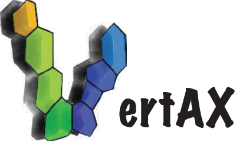
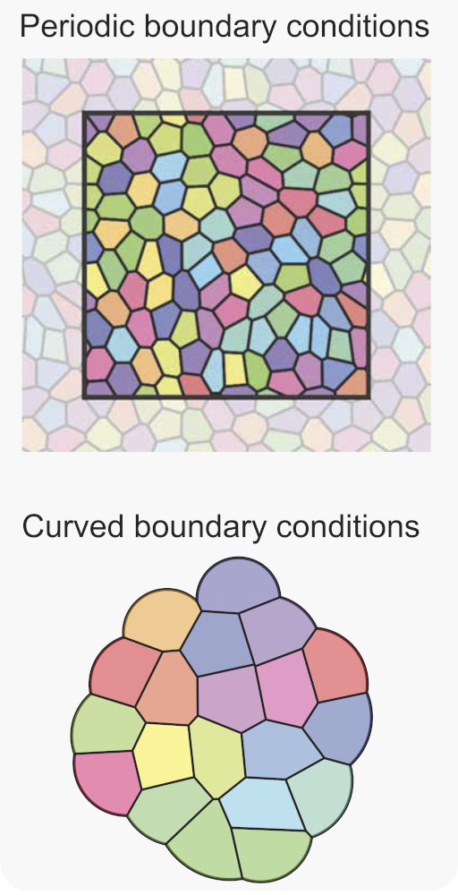

<div align="left">

<!-- Badges -->

[](https://arxiv.org/abs/2604.06896)
[](https://www.gnu.org/licenses/gpl-3.0)
[](https://html-preview.github.io/?url=https://github.com/VirtualEmbryo/VertAX/blob/main/docs/vertax.html)

<!-- PyPI badge removed 2026-08-15: `vertax` / `vertAX` are both unregistered on PyPI
     (pypi.org/pypi/vertax/json returns HTTP 404), so the badge rendered as "unknown" and
     `pip install vertax` failed. Restore it when the package is actually published:
     [](https://pypi.org/project/vertAX) -->

<!-- [](https://zenodo.org/badge/latestdoi/144513571) -->

</div>

<table border="0" cellspacing="0" cellpadding="0">
<tr>
<td width="40%" border="0">



</td>
<td width="60%" border="0">
<b>
A differentiable JAX-based framework<br>
for vertex modeling and inverse design of epithelial tissues.
</b>
<br><br>

[](https://github.com/VirtualEmbryo/VertAX) <br><b>— all in one unified Python package.</b>

</td>
</tr>
</table>

---

## What is VertAX?

Epithelial tissues dynamically reshape through local mechanical interactions among cells. Understanding, inferring, and designing these mechanics is a central challenge in developmental biology and biophysics. **VertAX** is a computational framework built to address this challenge.

**VertAX** is a **framework for vertex-based modeling**: it represents epithelial tissues as two-dimensional polygonal meshes in which cells are faces, junctions are edges, tricellular contacts are vertices, and mechanical equilibrium is defined by the minimum of a user-specified energy. Built on **JAX**, VertAX is designed not only for forward simulation, but also for inverse problems such as parameter inference and tissue design.

---

## Conceptual Overview

VertAX treats inverse modeling as a **bilevel optimization** problem:

$$
\begin{aligned}
\textbf{Outer problem (learning):} \quad
\theta^{\ast} &= \arg\min_{\theta} \mathcal{C}\left(X^{\ast}_{\theta},\theta\right)
&& \leftarrow \text{fit data or reach a target} \\
\textbf{Inner problem (physics):} \quad \text{s.t.}&
X^{\ast}_{\theta} \in \arg\min_{X} \mathcal{E}(X,\theta)
&& \leftarrow \text{compute mechanical equilibrium}
\end{aligned}
$$

Here, $X$ denotes the tissue configuration, i.e. the vertex positions of the mesh, and $\theta$ denotes the model parameters, such as line tensions, target areas, or shape factors.

In other words, VertAX repeatedly solves a mechanical equilibrium problem for a given parameter set $\theta$, then updates those parameters to better match data or a design objective.

<p align="center">
  <br>
  <em>Figure: Bilevel optimization loop in VertAX.</em>
</p>

---

## Core Features

- 🧩 **Bilevel optimization framework**  
  VertAX formulates inverse problems as nested optimization: an inner mechanical equilibrium problem and an outer parameter-learning problem.

- 🔬 **Multiple gradient strategies**  
  Four outer-gradient estimators: **Automatic Differentiation (AD)**, **sensitivity Implicit Differentiation (Sen-ID)**, **Adjoint-state Implicit Differentiation (Adj-ID)**, and a **centered (two-sided) Equilibrium Propagation (EP)** estimator.

- 🔁 **Differentiable and non-differentiable workflows**  
  VertAX supports fully differentiable pipelines, while EP also enables inverse modeling with simulators that are only accessible through repeated executions.

- ⚡ **GPU acceleration with JAX**  
  JIT compilation and vectorization enable efficient simulations on CPU and GPU.

- 🎨 **Custom energies and costs in plain Python**  
  Define your own mechanical models and inverse-design objectives without changing the library internals.

- 🏗️ **Two simulation modes**  
  Supports both periodic tissues (bulk mechanics) and bounded tissues (finite clusters with curved interfaces).

- 🔀 **Automatic topology changes**  
  Handles T1 neighbor exchanges during optimization.

- 🔗 **Seamless ML integration**  
  Designed to work naturally with the JAX/Optax ecosystem.

---

## Installation

We recommend installing VertAX in a virtual environment:

```sh
python -m venv .venv
source .venv/bin/activate
```

### From source

```sh
git clone https://github.com/VirtualEmbryo/VertAX.git
cd VertAX
pip install -e .
```

### From PyPI

**Not yet published.** VertAX is not on PyPI, so `pip install vertax` will not work — install from
source as above.

**Dependencies**: JAX and JAXlib, Optax, JAXopt, NumPy, SciPy (Voronoi initialization),
Matplotlib (plotting), scikit-image and tifffile (image input), pandas, and Cellpose (segmentation
of microscopy images). Exact pins are in `pyproject.toml`; `uv.lock` and `requirements.txt` are
generated from it and kept in sync by the `uv` pre-commit hooks.

For GPU support, install JAX with CUDA as described in the [JAX docs](https://github.com/google/jax#installation) before installing VertAX.

### Numerical precision

VertAX follows JAX's default float dtype: `float32` unless you enable 64-bit mode, in which case
meshes and relaxations are `float64`. Enable it before the first JAX array is created:

```python
import jax
jax.config.update("jax_enable_x64", True)   # or set the environment variable JAX_ENABLE_X64=1
```

or scope it with `jax.experimental.enable_x64()` as a context manager. Meshes built afterwards
(`PbcMesh`, `BoundedMesh`) are `float64`, and no cast is needed. Mesh integer tables stay `int32`
in both modes. Use `float64` for Hessian, conditioning and equilibrium-residual work; the
rheometry and clamped-patch modules below require it.

---

## Simulation modes

VertAX supports two complementary simulation modes, designed for different classes of epithelial mechanics problems. The **periodic** mode is best suited for bulk tissue dynamics without explicit external boundaries, while the **bounded** mode is designed for finite tissue clusters with curved free interfaces. Both modes share the same vertex-based formulation and optimization framework, but differ in how boundaries are represented and initialized.

<table>
  <tr>
    <th>Mode</th>
    <th>Use case</th>
    <th>Initialization</th>
    <th>Illustration</th>
  </tr>
  <tr>
    <td><b>Periodic</b></td>
    <td>Bulk tissue dynamics, no explicit boundaries</td>
    <td>Random Voronoi seeds or segmented images (Cellpose)</td>
    <td rowspan="2" align="center">
      
    </td>
  </tr>
  <tr>
    <td><b>Bounded</b></td>
    <td>Finite tissue clusters with curved interfaces</td>
    <td>Random Voronoi seeds; boundary arcs as additional degrees of freedom (DOFs)</td>
  </tr>
</table>

---

## Gradient Strategies

VertAX implements and benchmarks four complementary methods for computing outer gradients through the implicit inner problem:

| Method                     | How it works                                                                                              | Pros                                                               | Cons                                                  |
| -------------------------- | --------------------------------------------------------------------------------------------------------- | ------------------------------------------------------------------ | ----------------------------------------------------- |
| **AD** (Automatic Diff.)   | Reverse-mode `jax.grad` through the **unrolled** inner solve (`BilevelOptimizationMethod.AUTOMATIC_DIFFERENTIATION`) | Exact for differentiable pipelines; easy in JAX                    | Memory and cost scale with the number of unrolled inner iterations; incompatible with line-search inner solvers |
| **Sen-ID** (Implicit Diff.) | Differentiates the optimality condition ∇ₓE=0 via the Implicit Function Theorem, propagating sensitivities forward (`IMPLICIT_DIFFERENTIATION`) | No unrolling; constant memory; exact near equilibrium              | Requires a Hessian solve; cost grows with the number of parameters |
| **Adj-ID** (Adjoint state) | Same optimality condition, solved in the **adjoint** (VJP) direction instead (`ADJOINT_STATE`)             | One linear solve per outer step regardless of parameter count      | Requires a Hessian solve; sensitive to ill-conditioning |
| **EP** (Equilibrium Prop.) | **Centered, two-sided** estimator: solves for a free equilibrium at −β and a nudged equilibrium at +β, then takes (∇L\_nudged − ∇L\_free) / (2β); no backprop required | Memory-efficient; works with non-differentiable/incomplete solvers; the symmetric ∓β perturbation cancels the leading-order O(β) bias, giving a lower-variance, more accurate gradient than a one-sided (0 → +β) estimate | Still a finite-β approximation of the exact implicit gradient (residual error scales as O(β²)); requires two inner solves per outer step; accuracy depends on choice of β |

**In practice**: VertAX's EP estimator is a centered second-order estimator based on symmetric ∓β perturbations, not a one-sided finite difference. AD and EP often recover similar parameter trends on synthetic inverse problems, while EP is especially attractive for simulators that cannot be made fully differentiable.

---

## Tutorials

See the [`examples/`](examples) folder for in-depth examples:

| Notebook                                  | Description                                                |
| ----------------------------------------- | ---------------------------------------------------------- |
| `inverse_modelling_example.ipynb`         | Inverse modeling with periodic boundary conditions         |
| `inverse_modelling_example_bounded.ipynb` | Inverse design with bounded cluster (convergent extension) |
| `pbc_from_image.ipynb`                    | Building a periodic mesh from a segmented microscopy image  |

For **tension inference specifically** — which settings matter, which metric to report, and which
conclusions from a run are trustworthy — see
[`docs/tension_inference_guide.md`](docs/tension_inference_guide.md). It collects the practical
results of the 2026-08 analysis campaign, including the mean-tension normalization constraint (which is **off by
default** and must be set explicitly) and why truncating the inner solve buys efficiency rather than
accuracy.

---

## API Reference

See the [documentation](https://html-preview.github.io/?url=https://github.com/VirtualEmbryo/VertAX/blob/main/docs/vertax.html).

---

## Further modules

* **Tracing a segmentation into a vertex mesh** (`vertax.trace`). Turns a label mask, including a raw
  crop with unsegmented margin, into a straight-edge mesh and reports which vertices are free or clamped.

  ```python
  import tifffile
  from vertax import trace_mask_closed

  mesh = trace_mask_closed(tifffile.imread("tests/trace_fixture_demo_003_pos2_mask.tif"))
  print(mesh.n_verts, int(mesh.free.sum()))   # vertices, and those with a complete force balance
  ```

* **Clamped-rim force balance on cropped tissues** (`vertax.clamped`). Relaxes the free vertices of a
  traced patch with the clamped ones held at their observed positions, and reports the residual over
  free degrees of freedom only. Requires `float64`.

  ```python
  import jax.numpy as jnp
  from jax.experimental import enable_x64
  from vertax.clamped import load_mesh, patch_geometry, relax

  with enable_x64():
      patch = load_mesh("tests/fixtures/clamped_patch_demo_003_pos2.npz")
      gamma = jnp.ones(len(patch.EA))                      # one tension per cell-cell edge

      def E(x, K):
          A, P, L = patch_geometry(x, patch)
          return 0.5 * K * jnp.sum((A - 1.0) ** 2) + jnp.sum(gamma * L)

      out = relax(E, patch, K=5.0)
      print(out["r_eq"], out["min_area"])                  # residual; smallest signed area
  ```

* **Bulk shear rheometry and its inverse design** (`vertax.rheology`, `ShearRheologyOptimizer`).
  Drives a periodic tissue with a cosine force mode, reads the compliance from the response, and
  designs parameters against a target modulus. Requires `float64`.

  ```python
  import math
  import jax.numpy as jnp
  from jax.experimental import enable_x64
  from vertax import PbcMesh
  from vertax.energy import energy_shape_factor_homo
  from vertax.rheology import make_drive_energy, make_shear_mode, mode_amplitude

  side = math.sqrt(20.0)
  with enable_x64():
      mesh = PbcMesh.from_random_seeds(nb_seeds=20, width=side, height=side, random_key=231)
      verts = jnp.asarray(mesh.vertices, dtype=jnp.float64)
      mode = make_shear_mode(verts, side, side, n=1)       # built from the undriven reference state

      def energy(v, h, f, _vp, _hp, fp):
          return energy_shape_factor_homo(v, h, f, side, side, jnp.atleast_1d(jnp.asarray(fp)))

      driven = make_drive_energy(energy, mode, 0.02)       # use as `loss_function_inner`
      print(mode_amplitude(verts, mode))                   # response amplitude (0 at the reference)
  ```

* **Image-based cost** (`cost_dmic`, `make_cost_dmic`, `render_interface_image`). Renders the mesh
  interfaces as a blurred image and compares it with an observed image, so the outer loss needs no
  vertex correspondence.

  ```python
  import jax.numpy as jnp
  from jax.experimental import enable_x64
  from vertax import PbcMesh
  from vertax.cost import make_cost_dmic, render_interface_image

  with enable_x64():
      mesh = PbcMesh.load_mesh("tests/fixtures/mesh_1008.npz")
      image = render_interface_image(jnp.asarray(mesh.vertices, jnp.float64), jnp.asarray(mesh.edges),
                                     float(mesh.width), float(mesh.height), 64, 0.3)
      loss_outer = make_cost_dmic(sigma_psf=0.3)           # for `loss_function_outer`
  ```

### Running the tests

```sh
uv run pytest              # default suite; long-running tests are deselected
uv run pytest -m long      # the long-running tests only (tens of minutes, several GB of RAM)
```

---

## Quick Start — Inverse Modeling

VertAX can also optimize model parameters to match a target geometry.

```python
import math
import jax
import jax.numpy as jnp
import optax

from vertax import PbcBilevelOptimizer, PbcMesh, BilevelOptimizationMethod, plot_mesh
from vertax.cost import cost_v2v
from vertax.energy import energy_shape_factor_hetero

# --- Mesh setup ---
n_cells = 20
width = height = math.sqrt(n_cells)

# New mesh with Periodic Boundary Conditions and 20 cells.
mesh = PbcMesh.from_random_seeds(
    nb_seeds=n_cells, width=width, height=height, random_key=0
)

# --- Attach parameters ---
mesh.vertices_params = jnp.zeros(mesh.nb_vertices)
mesh.edges_params    = jnp.zeros(mesh.nb_half_edges)   # not used here
mesh.faces_params    = jnp.full(mesh.nb_faces, 3.7)    # initial target shape factors

selected_faces = jnp.arange(mesh.nb_faces)

# --- Built-in energy function ---
def energy(vertTable, heTable, faceTable, _vert_params, _he_params, face_params):
    return energy_shape_factor_hetero(
        vertTable, heTable, faceTable,
        width, height,
        selected_faces,
        face_params,
    )

# --- Optimizer setup ---
optimizer = PbcBilevelOptimizer()
optimizer.loss_function_inner = energy
optimizer.inner_solver = optax.sgd(learning_rate=0.01)
optimizer.update_T1 = True
optimizer.min_dist_T1 = 0.005

# --- Relax the initial mesh ---
optimizer.inner_optimization(mesh)

# --- Create a target mesh with different face parameters ---
target = PbcMesh.copy_mesh(mesh)

key = jax.random.PRNGKey(1)
target.faces_params = 3.7 + 0.2 * jax.random.normal(key, shape=(target.nb_faces,))
target.vertices_params = jnp.zeros(target.nb_vertices)
target.edges_params    = jnp.zeros(target.nb_half_edges)

optimizer.inner_optimization(target)

# --- Register the target ---
optimizer.vertices_target = target.vertices.copy()
optimizer.edges_target    = target.edges.copy()
optimizer.faces_target    = target.faces.copy()

# --- Outer loss and bilevel method ---
optimizer.loss_function_outer = cost_v2v
optimizer.outer_solver = optax.adam(learning_rate=1e-4, nesterov=True)
optimizer.bilevel_optimization_method = BilevelOptimizationMethod.EQUILIBRIUM_PROPAGATION

# --- Run bilevel optimization ---
for epoch in range(20):
    optimizer.bilevel_optimization(mesh)

plot_mesh(mesh, title="Recovered mesh after inverse modeling")
```

For full inverse-modeling examples, see [Tutorials](#tutorials) section.

---

## Citing VertAX

If you use _VertAX_ in your research, please cite:

```

@misc{pasqui2026vertaxdifferentiablevertexmodel,
            title={VertAX: a differentiable vertex model for learning epithelial tissue mechanics},
            author={Alessandro Pasqui and Jim Martin Catacora Ocana and Anshuman Sinha and Matthieu Perez and Fabrice Delbary and Giorgio Gosti and Mattia Miotto and Domenico Caudo and Maxence Ernoult and Hervé Turlier},
            year={2026},
            eprint={2604.06896},
            archivePrefix={arXiv},
            primaryClass={cs.LG},
            url={https://arxiv.org/abs/2604.06896},
}
```

<!-- > Pasqui A., Catacora Ocana J.M., Sinha A., Perez M., Delbary F., Gosti G., Miotto M., Caudo D., Ruocco G., Ernoult M.\*, Turlier H.\* (2025). _VertAX: A Differentiable Vertex Model for Learning Epithelial Tissue Mechanics._ -->

<!-- If a DOI or preprint becomes available, we also recommend citing that version. -->

---

## Funding

This project received funding from the European Union’s Horizon 2020 research and innovation programme under the **European Research Council** (ERC) grant agreement no. **949267**, and under the **Marie Skłodowska-Curie** grant agreement no. **945304** — Cofund **AI4theSciences**, hosted by **PSL University**. AP, JMCO, AS, FB, MP, FD and HT acknowledge support from CNRS and Collège de France

---

## License

VertAX is free software: you can redistribute it and/or modify it under the terms of the GNU General Public License as published by the Free Software Foundation, either version 3 of the License, or (at your option) any later version.

VertAX is distributed in the hope that it will be useful, but WITHOUT ANY WARRANTY; without even the implied warranty of MERCHANTABILITY or FITNESS FOR A PARTICULAR PURPOSE. See the GNU General Public License for more details. The full text is in [`LICENSE`](LICENSE); you should also have received it with this program, otherwise see <https://www.gnu.org/licenses/>.

Copyright holders and contributors are listed in [`AUTHORS`](AUTHORS).
